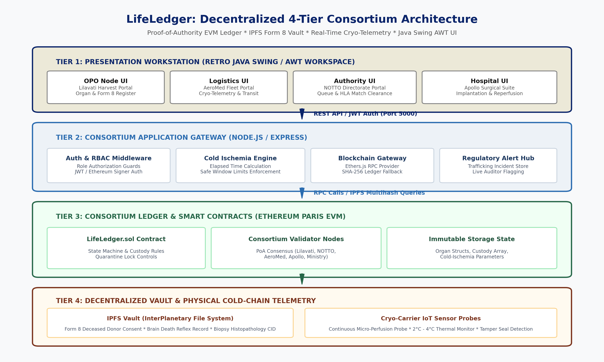
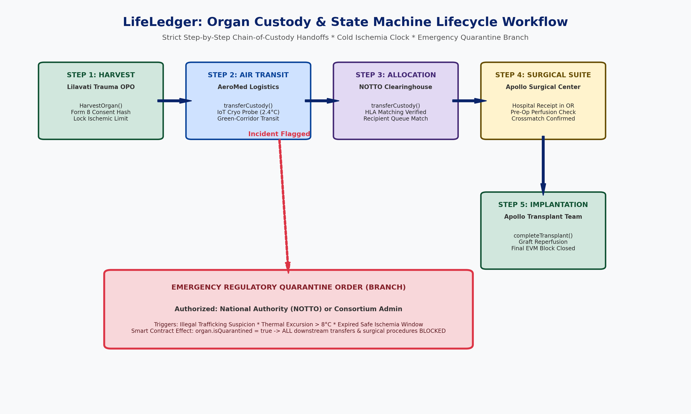
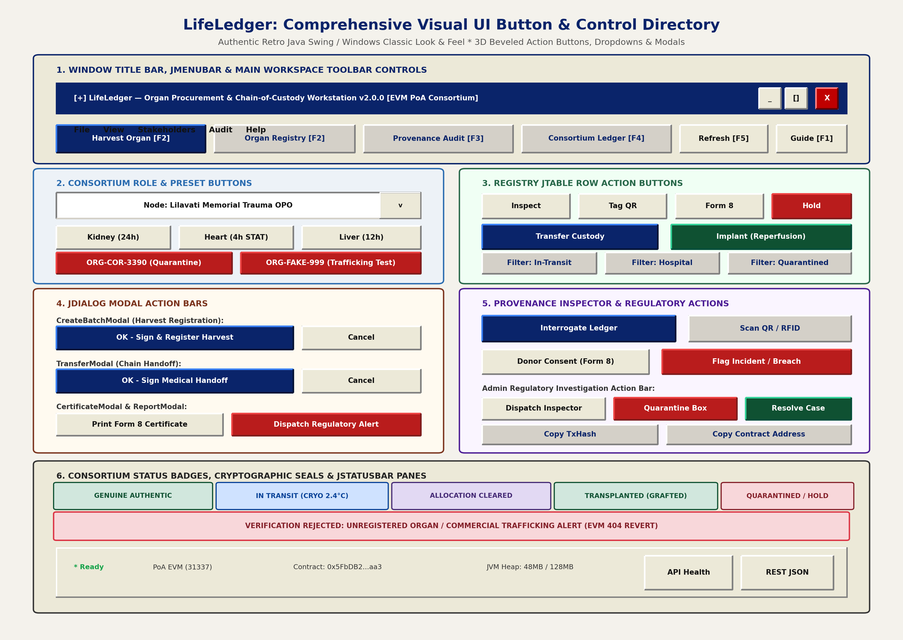
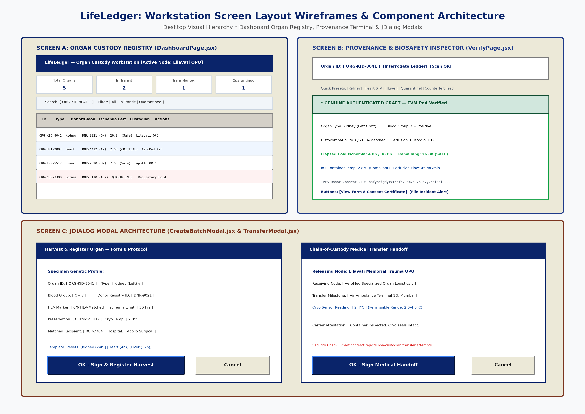

# 🫀 LifeLedger: User Interface Specification, Button Directory & System Architecture

> **Comprehensive Engineering & Operational Manual**  
> *Consortium Proof-of-Authority EVM Network • Retro Java Swing / AWT UI Workstation*  
> *Author: Soham Bhale | Project: LifeLedger (v2.0.0 Production Release)*

---

## 📑 Table of Contents
1. [Executive Summary & Problem Statement](#1-executive-summary--problem-statement)
2. [4-Tier System Architecture Diagram & Description](#2-4-tier-system-architecture)
3. [Organ Custody & State Machine Lifecycle Workflow](#3-organ-custody--state-machine-lifecycle-workflow)
4. [Exhaustive Button & UI Control Directory](#4-exhaustive-button--ui-control-directory)
   - [4.1 Navigation Bar, JMenuBar & JToolBar](#41-navigation-bar-jmenubar--jtoolbar)
   - [4.2 Organ Custody Registry Table (DashboardPage)](#42-organ-custody-registry-table-dashboardpage)
   - [4.3 Organ Provenance & Biosafety Inspector (VerifyPage)](#43-organ-provenance--biosafety-inspector-verifypage)
   - [4.4 Consortium Distributed Ledger Explorer (ExplorerPage)](#44-consortium-distributed-ledger-explorer-explorerpage)
   - [4.5 Modal Dialogs (JDialogs) & Control Directory](#45-modal-dialogs-jdialogs--control-directory)
   - [4.6 Standard Desktop Status Bar (JStatusBar)](#46-standard-desktop-status-bar-jstatusbar)
5. [Chronological Step-by-Step Operator Workflow](#5-chronological-step-by-step-operator-workflow)
6. [Academic & Regulatory Defense: Why Blockchain vs. Traditional MongoDB/SQL?](#6-academic--regulatory-defense-why-blockchain-vs-traditional-mongodbsql)

---

## 1. Executive Summary & Problem Statement

Human organ transplantation represents one of modern medicine’s most miraculous achievements, yet it remains hindered by critical logistical and integrity bottlenecks:
* **Black-Market Commercial Trafficking:** Organs procured without legal consent or through financial coercion.
* **Falsified Donor Consent Documentation:** Forged neurological brain-death records and Form 8 certificates.
* **Ischemic Window Cell Death:** Delay in transit exceeding strict medical windows (Heart: 4h, Liver: 12h, Kidney: 24h, Lung: 8h, Cornea: 48h).
* **Thermal Excursions:** Hypothermic container refrigeration failure (>8°C) during highway or air ambulance transit.

**LifeLedger** solves these vulnerabilities by pairing an immutable **EVM Smart Contract** (`LifeLedger.sol`) on a Proof-of-Authority (PoA) consortium network with decentralized IPFS document storage, IoT cryo-telemetry, and an authentic retro Java Swing desktop GUI.

---

## 2. 4-Tier System Architecture

The LifeLedger architecture decouples hardware sensors, blockchain logic, REST APIs, and presentation into 4 resilient tiers:



### Tier 1: Presentation Workstation (Retro Java Swing / AWT UI)
* **Design Philosophy:** Windows Classic / Java Swing desktop look (`#ECE9D8` base, 2px 3D beveled borders `.swing-raised` & `.swing-sunken`, Tahoma typography).
* **Components:** `JMenuBar`, `JToolBar` with beveled action buttons, `JTable` with compact rows and `#0A246A` selection, `JDialog` modal windows, and `JStatusBar`.
* **Technology:** React 19, Vite, Tailwind CSS with subpixel font-smoothing.

### Tier 2: Consortium Application Gateway (Node.js / Express)
* **RBAC Engine:** Role-Based Access Control enforcing valid signing addresses for OPOs, Logistics, Allocation Authorities, and Hospitals.
* **Cold Ischemia Telemetry Engine:** Dynamically calculates elapsed hours vs. safe limit countdowns in real-time.
* **Resilient Ledger Fallback:** Ethers.js integration with cryptographic SHA-256 local state ledger fallback.

### Tier 3: Consortium Ledger & Smart Contracts (Solidity Paris EVM)
* **`LifeLedger.sol`:** State machine governing custody ownership, ischemic limits, and emergency quarantine locks.
* **PoA Consensus:** Validated by authenticated stakeholder nodes (Lilavati OPO, AeroMed, NOTTO, Apollo Hospital, Ministry of Health) with 1-2 second block finality and zero volatile gas costs.

### Tier 4: Decentralized Vault & Physical Hardware
* **IPFS Multihash Vault:** Stores high-resolution Form 8 Deceased Donor Living Wills, Brain Death reflex evaluations, and biopsy histopathology CIDs.
* **IoT Cryo Probes:** Continuous temperature monitoring ensuring organs remain within safe hypothermic perfusion bounds (2.0°C - 4.0°C).

---

## 3. Organ Custody & State Machine Lifecycle Workflow

Every organ follows an immutable sequential path:



```
[ DECEASED DONOR FORM 8 CONSENT ]
             │
             ▼
      STEP 1: HARVEST
   Lilavati Trauma OPO
   - harvestOrgan()
   - Form 8 Hash Locked
   - Ischemia Clock Starts
             │
             ▼
    STEP 2: AIR TRANSIT
     AeroMed Logistics
   - transferCustody()
   - IoT Probe: 2.4°C
   - Green Corridor Flight
             │
             ▼
   STEP 3: ALLOCATION
    NOTTO Clearinghouse
   - transferCustody()
   - HLA Match Verified (6/6)
   - Recipient Queue Priority
             │
             ▼
  STEP 4: SURGICAL SUITE
   Apollo Surgical Center
   - Hospital OR Receipt
   - Perfusion Flow Check
   - Pre-Op Crossmatch
             │
             ▼
  STEP 5: IMPLANTATION
   Apollo Transplant Team
   - completeTransplant()
   - Graft Reperfusion Confirmed
   - Permanent State: Transplanted
```

### Emergency Quarantine Order (Consortium Freeze)
If suspected human trafficking, a forged Form 8 certificate, or a thermal excursion (>8°C) is reported:
* Any authorized **NOTTO Authority** or **Consortium Admin** node invokes `quarantineOrgan(organId, reason)`.
* `organ.isQuarantined` is permanently flagged `true`.
* Smart contract instantly rejects all further `transferCustody()` or `completeTransplant()` attempts consortium-wide.

---

## 4. Exhaustive Button & UI Control Directory



### 4.1 Navigation Bar, JMenuBar & JToolBar

| Control Element | UI Type | Technical Trigger & System Effect |
|---|:---:|---|
| **File Menu** | `JMenu` | Opens menu dropdown: *Harvest Donor Organ (Ctrl+N)*, *Print Specimen Tag*, and *Exit Workstation*. |
| **View Menu** | `JMenu` | Switches active workspace view: *Organ Custody Registry (F2)*, *Provenance Inspector (F3)*, *Consortium Explorer (F4)*. |
| **Stakeholders Menu** | `JMenu` | Switches active Ethereum signer context between the 5 approved consortium organizations. |
| **Help Menu** | `JMenu` | Displays: *System Architecture & Viva Defense Manual (F1)*, *API Health Status*, and *Sample REST JSON*. |
| **`[Harvest Organ [F2]]`** | `JToolBar Button` | Available to OPO & Admin. Launches `CreateBatchModal` to register a newly procured donor graft on-chain. |
| **`[Registry]`** | `JToolBar Button` | Switches active view to the main organ inventory grid (`DashboardPage`) with real-time cold-ischemia clocks. |
| **`[Provenance]`** | `JToolBar Button` | Navigates to the public verification inspection terminal (`VerifyPage`) for cryptographic donor audits. |
| **`[Consortium]`** | `JToolBar Button` | Opens the Proof-of-Authority node explorer (`ExplorerPage`) displaying validator health and block activity. |
| **`[Refresh (F5)]`** | `JToolBar Button` | Queries `GET /api/organs` and `GET /api/stats` to refresh elapsed ischemic hours and update live telemetry. |
| **`Kidney / Heart / Liver`** | `JToolBar Presets` | One-click role switchers that automatically load the appropriate workstation actor and specimen view. |
| **`Consortium Entity`** | `JComboBox Dropdown` | Dynamically changes the active cryptographic signing account (OPO, Logistics, Authority, Hospital, Admin). |
| **`Active Alerts Badge`** | `JBadge Indicator` | Displays the current count of open human trafficking investigations; clicking switches to Admin view. |
| **`[Defense Guide [F1]]`** | `JToolBar Button` | Opens `PresentationGuideModal` containing viva defense talking points and demonstration scripts. |

---

### 4.2 Organ Custody Registry Table (`DashboardPage`)

| Control Element | UI Type | Technical Trigger & System Effect |
|---|:---:|---|
| **Filter Tabs** | `JButton Filter` | Filters grid rows: *All Records*, *In Transit (Cryo)*, *Allocation Cleared*, *Transplanted*, or *Quarantined*. |
| **Search Registry** | `JTextField` | Live case-insensitive search matching Organ ID, Organ Type, Blood Group, Donor ID, or Hospital. |
| **Table Row Click** | `JTable Selection` | Highlights the active row in classic navy `#0A246A` and contextualizes row action buttons. |
| **`[Inspect]` (Eye)** | `Table Action Button` | Pre-loads the selected organ ID into `VerifyPage` for an immediate end-to-end provenance audit. |
| **`[Tag]` (QrCode)** | `Table Action Button` | Opens `QRCodeModal` displaying the printable Cryo-Carrier Specimen Manifest with cryptographic QR barcode. |
| **`[Form 8]` (Award)** | `Table Action Button` | Opens `CertificateModal` displaying the legal Deceased Donor Consent and Brain Death Clearance Certificate. |
| **`[Transfer]` (Truck)** | `Table Action Button` | Available to current custodian. Opens `TransferModal` to execute a multi-party custody handoff on-chain. |
| **`[Implant]` (Heart)** | `Table Action Button` | Available to Hospital nodes when organ is received in OR. Completes surgical sign-off (`completeTransplant`). |
| **`[Hold]` (ShieldAlert)** | `Table Action Button` | Issues an emergency regulatory quarantine order, immediately locking the organ consortium-wide. |

---

### 4.3 Organ Provenance & Biosafety Inspector (`VerifyPage`)

| Control Element | UI Type | Technical Trigger & System Effect |
|---|:---:|---|
| **Organ Registry ID Input** | `JTextField` | Accepts specimen barcode string (e.g., `ORG-KID-8041`, `ORG-HRT-2094`). |
| **`[Interrogate Ledger]`** | `JButton Primary` | Executes `GET /api/verify/:organId` against the EVM blockchain and displays verified custody timeline. |
| **`[Scan QR / RFID]`** | `JButton Tool` | Opens `QRScannerModal` to decode physical specimen QR tags via webcam or uploaded graphic files. |
| **`Preset: ORG-KID-8041`** | `JButton Preset` | Instantly loads kidney specimen in active cryo-transit (O+ blood group, 24h limit, Custodiol perfusion). |
| **`Preset: ORG-HRT-2094`** | `JButton Preset` | Instantly loads critical heart specimen in air transit under 4-hour emergency ischemia timer. |
| **`Preset: ORG-LVR-5512`** | `JButton Preset` | Instantly loads liver specimen received in surgical suite ready for operating theater implantation. |
| **`Preset: ORG-COR-3390`** | `JButton Preset` | Demonstrates regulatory quarantine lock state due to biosafety or chain-of-custody discrepancy. |
| **`Preset: ORG-FAKE-999`** | `JButton Preset` | Demonstrates anti-trafficking counterfeit detection (returns 404 UNREGISTERED ORGAN alert). |
| **`[Donor Consent (Form 8)]`** | `JButton Dialog` | Opens modal rendering official Form 8 brain death clearance anchored to IPFS CID multihash. |
| **`[Flag Incident]`** | `JButton Danger` | Opens `ReportModal` to file an emergency whistleblower report on thermal failure or illegal trafficking. |
| **`[Copy TxHash]`** | `JButton Tool` | Copies the Ethereum transaction hash of any custody milestone directly to system clipboard. |
| **`[Open Portal]`** | `JButton Portal` | Switches the user interface directly to the active stakeholder's administrative workstation. |

---

### 4.4 Consortium Distributed Ledger Explorer (`ExplorerPage`)

| Control Element | UI Type | Technical Trigger & System Effect |
|---|:---:|---|
| **`[Refresh Ledger (F5)]`** | `JButton Tool` | Queries `GET /api/stats` to update PoA block height, validator peer count, and active cases. |
| **`[Copy Address]`** | `JButton Copy` | Copies the public Ethereum hexadecimal address of any consortium validator node. |
| **Stakeholder Grid** | `JTable` | Displays the 5 approved validator nodes (NOTTO, Lilavati, AeroMed, Apollo, Ministry) with live online status. |
| **Verification Log** | `JTable` | Displays the chronological audit log of all query pings, device types, and tamper-evident responses. |

---

### 4.5 Modal Dialogs (JDialogs) & Control Directory

#### 1. Harvest & Register Organ Dialog (`CreateBatchModal`)
* **`Fast Templates (Kidney / Heart / Liver)`:** Auto-fills organ anatomical data, typical cold-ischemia limits, and preservation protocols.
* **`[OK - Sign & Register Harvest]`:** Submits `POST /api/organs`, triggers EVM `harvestOrgan()` call, anchors Form 8 hash, and initializes the cold-ischemia countdown.
* **`[Cancel]` / `[X]`:** Closes dialog without modifying on-chain state.

#### 2. Custody Transfer Protocol Dialog (`TransferModal`)
* **`Select Consortium Entity` (JComboBox):** Chooses the authorized recipient node (e.g. AeroMed Logistics, NOTTO Authority, Apollo Hospital).
* **`Transfer Point / Milestone`:** Logs location checkpoint (e.g., *Air Ambulance Terminal 1D*, *OR Suite #3*).
* **`Cryo Container Temp (°C)`:** Records probe reading (e.g., *2.4°C*).
* **`[OK - Sign Medical Handoff]`:** Submits `POST /api/organs/:id/transfer`, records cryptographic signature on-chain, and advances stage.

#### 3. Specimen RFID/QR Manifest Dialog (`QRCodeModal`)
* **`[Copy Verify URL]`:** Copies direct web verifier URL (`http://localhost:5173/verify/ORG-KID-8041`).
* **`[Print Carrier Tag]`:** Invokes `window.print()` to generate physical adhesive shipping labels for hypothermic canisters.

#### 4. Form 8 Donor Consent Certificate Dialog (`CertificateModal`)
* **`[Print Form 8 Certificate]`:** Prints the statutory deceased donor consent, brain death reflex evaluation, and pathogen serology clearance.

#### 5. Regulatory Incident & Anti-Trafficking Alert Dialog (`ReportModal`)
* **`Violation Category Dropdown`:** Selects infraction: *Thermal Excursion (>8°C)*, *Commercial Trafficking*, *Forged Form 8*, *Expired Ischemia*.
* **`[OK - Dispatch Regulatory Alert]`:** Submits `POST /api/verify/report`, logs case in central audit registry, and flags auditors.
* **`[Switch to Regulatory Admin]`:** Instantly loads the NOTTO Directorate workstation to quarantine the compromised organ.

#### 6. Optical Barcode Scanner Dialog (`QRScannerModal`)
* **`Webcam Scanner` Tab:** Initiates camera video stream with live bounding box to decode physical QR stickers.
* **`Demo Presets` Tab:** Allows instant simulation of scanning test organs without needing physical camera access.
* **`[Load QR Image File]`:** Uploads an image from disk to parse QR barcode multihash.

#### 7. Viva Defense & Architecture Guide (`PresentationGuideModal`)
* **Tabs (`Live Demo Flow`, `Viva Defense`, `Smart Contract Rules`, `Architecture`):** Displays examiner defense talking points.

---

### 4.6 Standard Desktop Status Bar (`JStatusBar`)

| Status Pane | Type | Information Displayed |
|---|:---:|---|
| **`Ready`** | Indicator | Pulsing green LED confirming the client workstation is active and synchronized. |
| **`PoA Consortium`** | Text Pane | Confirms connection to Ethereum Paris EVM network (Chain ID: `31337`). |
| **`LifeLedger.sol Address`** | Text Pane | Displays deployed contract address (`0x5FbDB2315678afecb367f032d93F642f64180aa3`). |
| **`JVM Heap Simulation`** | Text Pane | Displays simulated Java Virtual Machine memory heap allocation (`48MB / 128MB`). |
| **`[API Health]`** | Action Link | Direct link opening `http://localhost:5000/api/health` to verify backend gateway responsiveness. |
| **`[REST JSON]`** | Action Link | Direct link inspecting raw JSON payload for `ORG-KID-8041` from the API. |
| **`[Defense Guide [F1]]`** | Action Button | Opens the full academic presentation and viva defense manual. |

### 4.7 Workstation Screen Layout Wireframes & Component Geometry



---

## 5. Chronological Step-by-Step Operator Workflow

For examiners, evaluators, or demonstration presentations, execute this 5-step sequence:

```
Step 1: OPO Node Harvest (Lilavati Trauma OPO)
 ├── Switch actor dropdown to "Organ Procurement Org (OPO)"
 ├── Click "[Harvest Organ [F2]]"
 ├── Choose preset "Kidney (24h)" -> Form 8 consent hash generated
 └── Click "[OK - Sign & Register Harvest]" -> Confirmed on EVM block

Step 2: Air-Ambulance Transit (AeroMed Logistics)
 ├── Switch actor dropdown to "Medical Transit Logistics"
 ├── Find the harvested organ in the registry table
 ├── Click "[Transfer]" -> Select destination & enter 2.4°C temperature
 └── Click "[OK - Sign Medical Handoff]" -> State: InTransit

Step 3: National Allocation Clearance (NOTTO Directorate)
 ├── Switch actor dropdown to "Allocation Authority"
 ├── Verify 6/6 HLA match and recipient queue priority
 └── Execute handoff to Apollo Surgical Hospital -> State: AllocationCleared

Step 4: Surgical Suite Implantation (Apollo Transplant Center)
 ├── Switch actor dropdown to "Transplant Hospital"
 ├── Notice organ is received in surgical suite
 ├── Click "[Implant]" -> Enter OR surgeon notes
 └── State: Transplanted (Grafted) -> Final EVM block closed

Step 5: Public Audit & Counterfeit Demonstration
 ├── Navigate to "Provenance" (VerifyPage)
 ├── Click "[ORG-KID-8041]" -> View cold ischemia timer & Form 8 IPFS CID
 └── Click "[ORG-FAKE-999]" -> Demonstrates instant anti-trafficking alert!
```

---

## 6. Academic & Regulatory Defense: Why Blockchain vs. Traditional MongoDB/SQL?

| Architectural Dimension | Traditional Centralized Database (MongoDB / SQL) | LifeLedger EVM Proof-of-Authority Consortium |
|---|---|---|
| **Multi-Party Trust** | **Fails:** Rival hospital networks and private air-ambulances refuse to grant each other DBA access. | **Succeeds:** Decentralized trustless validation. No single organization controls the ledger. |
| **Anti-Trafficking Integrity** | **Vulnerable:** Database administrator can covertly delete audit logs or alter donor timestamps. | **Mathematically Impossible:** Smart contracts enforce digital signatures. Block history is immutable. |
| **Rule Enforcement** | **Passive:** Databases store data passively. Application logic can be bypassed by SQL injection. | **Active / Programmable:** Smart contracts reject unauthorized transfers or expired cold ischemia windows. |
| **Consensus & Cost** | **N/A:** Central server is single point of failure. | **Deterministic:** PoA consensus provides instant 1-2s finality with zero volatile gas fees. |

---

*LifeLedger Documentation Suite • October 25, 2026 • Verified on EVM PoA Consortium*
